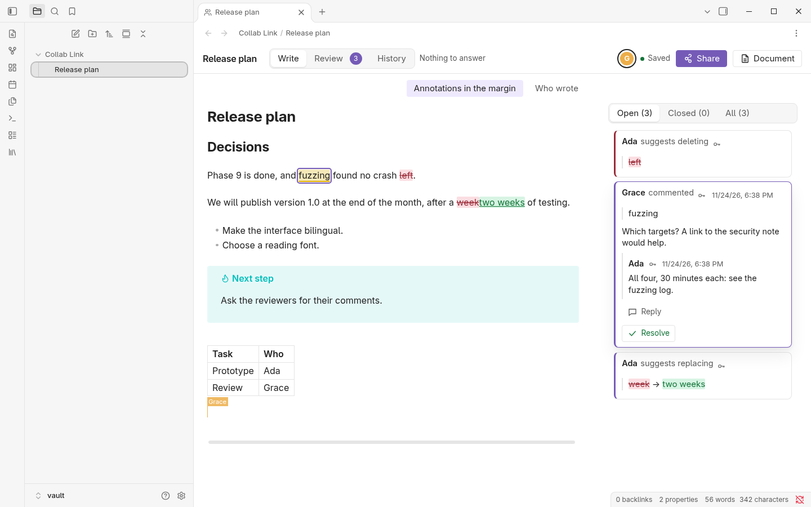
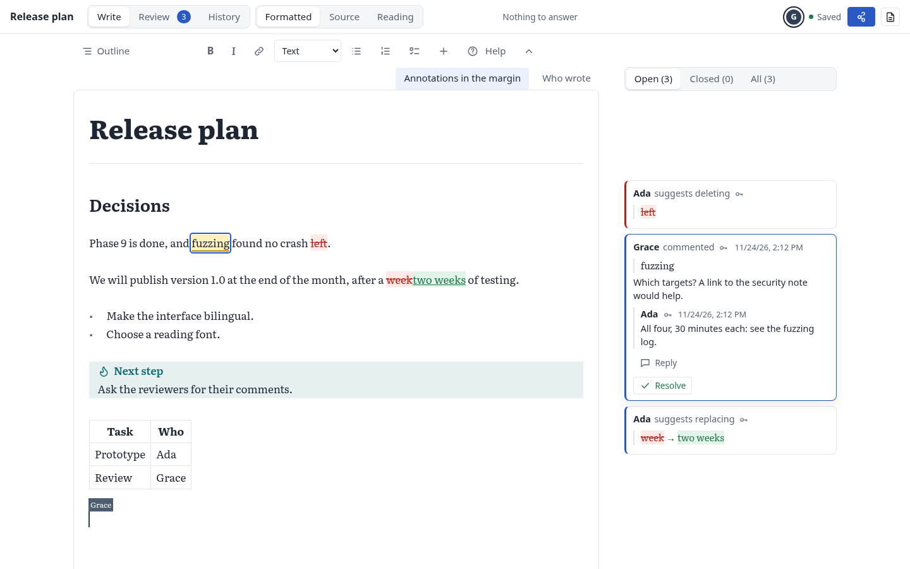

# Collab Link — an Obsidian plugin

Write a note with others, in real time and offline, end-to-end encrypted, with comments and suggestions. Anyone with its link can open it, in Obsidian with this plugin or in a browser with nothing to install.

<!-- These pictures are made by scripts, never by hand: `node scripts/readme-shot.mjs` in obsidian/ and `node scripts/ui/readme-shot.mjs` in web/ write docs/images/. Take them again whenever what they show changes (AGENTS.md §5). -->


The same document, in a browser:



**What it is for**: sharing a few notes for a while, to work on them with others — then, the work done, **unlinking** them, to keep them in your vault as ordinary notes. Links between the notes you share follow along: shared, they open for whoever has the other note's document; unlinked, they are `[[…]]` to your notes again.

Desktop only for now (`isDesktopOnly`); Obsidian 1.11.4 or later.

## A server first

**The plugin needs an obsidian-collab server**, deployed by you or your organisation: there is no public one. A shared note's document lives there, encrypted, and so does *My documents*. The server is free software, in the same repository as the plugin: one Rust executable that serves the web page and the API and keeps its data in a SQLite file, behind a reverse proxy that terminates TLS, with Docker or systemd — see the **[deployment guide](https://gitlab.com/matclab/obsidian-collab-link/-/blob/v0.8.5/deploy/README.md)**. A second executable, optional, the identity gateway, connects it to your organisation's OpenID Connect sign-in, for names shown as verified. Then write the server's address in the plugin's settings.

## Network use

The plugin connects only to:

- **the server of its settings, and the server each link you open names**: to send and receive the documents' changes, their attached images and *My documents*, all encrypted end to end on your device. The server sees encrypted blobs, document ids, sizes, the rhythm of changes, IP addresses and each connection's role — never the text, the keys or the pseudonyms.
- **the identity gateway of its settings**, only if you set one: to sign in (in the system's browser) and get your name attested. The gateway never sees a document.
- **the push service of Obsidian's browser engine**, only if you turn on notifications in the view: the server posts your alerts there, encrypted for your device; the push service never reads them.
- **other sites' images** that a document's text cites, only where Obsidian itself renders the note (see *Limits*), or once you allow them in the view.

No account is needed (the gateway is optional), no telemetry, no other service. The plugin is a client of the open [protocol](https://gitlab.com/matclab/obsidian-collab-link/-/blob/v0.8.5/docs/protocol/README.md), like the web page, built on the same [library](https://gitlab.com/matclab/obsidian-collab-link/-/blob/v0.8.5/web/lib/README.md); it shows the page's own view inside Obsidian, where you write in **Obsidian's own editor**.

## Install

Once listed in Obsidian's community plugins: *Settings → Community plugins → Browse*, search for *Collab Link*. Until then, from the source repository (Node.js 22 or later):

```sh
make obsidian-install VAULT_PATH=~/Notes     # at the root; or, in obsidian/: make install VAULT_PATH=~/Notes
```

`VAULT_PATH` is the vault's folder, the one that holds `.obsidian/` (quote it if it has spaces). This installs `web/`'s dependencies if they are missing, builds the plugin into `obsidian/dist/`, and copies `main.js`, `manifest.json` and `styles.css` into `<vault>/.obsidian/plugins/collab-link/`. Then reload Obsidian and enable *Collab Link* in its community plugins. `make obsidian-uninstall VAULT_PATH=…` removes those three files and keeps the plugin's `data.json`. `make help` (at the root or in `obsidian/`) lists the targets.

## Use

Nine commands:

- **Share this note** — on an ordinary note: creates a document on the server of the settings, puts the whole note in it (its properties included, and any CriticMarkup as comments and suggestions), and opens it in the plugin's view. **The note then changes status**: you write in the view; the file becomes an export that the plugin rewrites. The view's *Share* dialog gives the links by role — reader, reviewer (comments and suggestions), editor.
- **Open a link** — paste a link someone gave you: a note is created in the plugin's folder (setting, `Collab Link/` by default), named after the document's title, and opened in the view. A note already linked to that document is reopened instead.
- **Unlink this note** — the note becomes ordinary again, with its last text, its links to the notes of your vault written back as `[[…]]`. The document stays on the server.
- **Convert the links to shared notes** — the note's `[[…]]` to shared notes written as their addresses (below), for an editor of the note's document.
- **Obsidian preview alongside** — the note's file in Obsidian's own reading view, beside the plugin's: diagrams, `[[links]]` and embeds as Obsidian renders them (the view draws callouts itself, in the theme's colours). It follows the export (a second late) and shows no annotation.
- **My documents** (also a ribbon icon) — the vault's list of the documents you open or share, as the web page's home keeps it: kept on the server of the settings, encrypted end to end, the same on all your devices — *Add a device* shows a code whose address you paste on the other one, where the list's key goes. An entry opens in its note. With an identity gateway, *Sign in* opens your organisation's sign-in in the system's browser, which comes back to Obsidian (`obsidian://collab-link-auth`); what you write then reads **verified** under your name.
- **Open a document of My documents** — the list, filtered by title; the one chosen opens in its note.
- **Move the section up**, **Move the section down** — the heading the caret is under, with everything up to the next heading of its level or above, before the previous section of its level or after the next one, never out of its parent; for an editor. No hotkey by default: choose them in Obsidian's settings (in the page's editor, Ctrl/Cmd+Shift+Up and Down). A move that would change what the text means (a setext heading right after a paragraph, a code block left open) isn't made.

Opening a linked note in any way (file explorer, link, search) opens the plugin's view. One view per document: a second tab leads to the first.

**Writing**: in Write, the text is in Obsidian's editor — its commands and their hotkeys, Ctrl+F, Vim, `[[…]]` and `#tag` completion, other plugins' editor extensions, your theme's heading colours, its live preview. The rest of the view is the page's: its header, Review, History, the annotations in the margin, the selection's toolbar, sharing. The editor isn't the note's file: what you type goes to the document, and the file is its export (below). Ctrl+Z takes back what you typed, never what someone else wrote. A reader or reviewer gets the same editor, read only. Obsidian's editor isn't in its API: if a version of Obsidian changes it, the view says so and uses the page's editor, which a setting can also choose (with its own formatting, Source, Preview and Side by side).

**Outline**: the view has no outline of its own; Obsidian's outline lists the note's headings. A heading clicked there, or a link to a heading (`[[Note#Heading]]`), brings the view's caret to it; a link to a note already open in another tab goes to that tab.

Settings: the server's address (`https://…`, or `http://` to this machine only), a user name and password if the server protects the creation of documents and of *My documents* (sent only with those requests), the folder for opened links, the editor (Obsidian's or the page's), attached images written to the vault (on by default; turned off, the file cites `attachment:` again and the files written stay); the **identity gateway** and the **fingerprints of its attestation key**, as your organisation publishes them — *Read from the server* fills them in from the server, for you to compare before using them: whoever chooses these fingerprints chooses whose names read verified, so the plugin never takes them from the server alone.

**Signing**: what you write (comments, replies, decisions, versions) is signed with a key of the vault's list, or of this device without a list — never the text itself. An Obsidian installed with an old installer (Electron before 37) can't sign: the plugin says so once.

## Links between notes

A `[[…]]` names a note of *your* vault: the others don't have it, or have another one of that name. So, in a shared note:

- **A link to another shared note** — `[[B]]`, B being linked to a document — is written as B's document's **address without its key**, `[B](https://server/?doc=…)` (with `#h=Heading` for `[[B#Heading]]`): it opens B for whoever already has B's document, in Obsidian (its note, at the heading) as in a browser (from *My documents*), and gives nothing to whoever hasn't. This happens as you type (once the `[[…]]` is complete and the caret out of it; Ctrl+Z gives the `[[B]]` back), when you share a note (its links, and the links to it in the shared notes open here), and with the command **Convert the links to shared notes**.
- **A link to a heading of the note itself** (`[[#Heading]]`) works for everyone, in the view and in the page.
- **A link to a note that isn't shared** stays as written: it works for you; the others see it as a note of a participant's vault, not followed.
- **A shared document's full link pasted** goes in as its address without its key (its key would give its access to everyone who reads the note); a notice offers to keep the full link instead.
- **Unlinking** writes the addresses of the notes of your vault back as `[[…]]` — of the notes still linked, and of those you unlinked before, in any order.
- **Renaming a note** that a shared note links to (Obsidian updating the links): the shared note takes the rewrite as is, without a copy.

While a note is shared, Obsidian sees an address, not a note: **no graph, no backlinks, no hover preview** between shared notes; they come back once unlinked.

## What is where

- **The note's file** is the document's text, plus two properties in its YAML header: `collab-document` (the document's id — not a secret, the server knows it) and `collab-version` (the version the file reflects). It is rewritten a second after the text last changed, while its view is open; a closed note keeps its last export. Search, graph and other plugins see that text — **not the annotations**, which only the view shows. **Attached images**: the view writes each one it has opened to `images/<document id>/` under the plugin's folder, and the file cites it there (``) where the document says `attachment:…`; an image not written yet keeps `attachment:`. These files stay when the document no longer cites them, or is unlinked: they are your copy. Renaming or moving one by hand breaks the link: a change from outside then resumed would put that path in the document, where the others don't see the image.
- **The link**, which holds the document's key, is in Obsidian's secret storage (by vault, out of the vault's files, encrypted by the system keyring when there is one — the plugin says once if there is none). It is never in the note, `data.json` or `workspace.json`. A note synced to a device without its link asks for the link.
- **What is not sent yet** is kept on the device, encrypted, in Obsidian's IndexedDB, as the page does.
- **My documents** is kept on the device in Obsidian's IndexedDB (by vault): the list encrypted by its key, and its key, the old keys still to delete and the sign-in's token sealed by a key of this device kept in the secret storage — never in clear. The signing key of this device is there too, not extractable.
- **`data.json`** holds only preferences: pseudonym, language, Source and side by side (the page's editor), and the settings above (never the password).

## When the file changes outside the plugin

The plugin never reads a change to the file as an edit (git, another editor, a script, another plugin, Obsidian's properties editor). When the file is no longer an export of a version the document has:

1. the changed file is kept beside the note: `<note> (changed outside the plugin 2026-10-14 15h02).md`, without the two properties — never deleted by the plugin;
2. the note is rewritten as the export;
3. the view says where the copy is and, for an editor, offers **Resume this change**: the file's text is replayed on the version it changed, so that nothing received since is undone. The same change resumed twice — on two devices after a `git pull` — enters once.

The offer lasts as long as the view; after that, merge the copy by hand. A file synced from another device that is just an export (of a version this device has, or will receive) is not a change: no copy.

## Limits

- **Obsidian renders the file with its own rules** wherever it shows it — the preview alongside, a hover on a link to the note, an embed, a canvas: there, an editor's raw HTML is rendered (sanitised by Obsidian) and remote images are loaded, so an editor can learn when and from where you read. **The view's Write mode is Obsidian's editor**: its live preview loads them too, in the note itself, as you read or write it. Only the page's editor (a setting, or when Obsidian's can't be used) and the view's Review and History don't, unless you grant them, image by image or for the document.
- **An attached SVG written to the vault** shows in Obsidian as an image, without scripts; opened on its own outside Obsidian (a browser, from the file manager), it runs any script an editor of the document put in it. Turn off the setting to keep images off the disk.
- **What Obsidian draws in the view's editor keeps its accessibility limits**, as in any of Obsidian's notes: its task checkboxes have no accessible name (a screen reader announces a checkbox without its task), some callout titles are in a colour of too little contrast on a light theme (a *warning*'s orange), a link to a note not in the vault is faded below the contrast asked for on a dark theme (as Obsidian draws an unresolved link), a link's accessible name may differ from its text. The plugin's accessibility check leaves those rules out there, and only there.
- **An annotation inside a block Obsidian draws** (a callout, a table, a formula block): Obsidian's live preview draws the block in place of its text, so the annotation's marks and proposed text only show once the caret is in it. The block is framed (dashed; solid for the annotation chosen), and choosing its card puts the caret there, which shows the source — except in a table, whose cells Obsidian edits apart: there, the frame and the card are all there is.
- **Moving a section while someone types in it**: the text has no "move", only a cut and an insertion. What another person typed in the moved section and you haven't received yet (latency, or all the time they were offline) stays at the old place, alone, glued to the line before; what they typed elsewhere, the neighbouring section included, stays where it was typed.
- **A link to a shared note typed in the page's editor** (the setting, or when Obsidian's can't be used) isn't converted as you type: the command does it.
- **A shared note closed when another one is shared** keeps its `[[…]]` to it until you open it and run **Convert the links to shared notes** (the notice says how many).
- **A file dropped or pasted into a linked note stays in your vault**: Obsidian copies it there and writes `![[file]]` in the text; the link is shared, the file isn't, and the others see a link to nothing.
- **A plugin that rewrites the whole text through the editor** (`setValue`) replaces it all: nothing is lost, but what someone else typed meanwhile may end up beside its place.
- **The preview alongside is not strictly read only**: Obsidian keeps its edit button there, and its properties can be edited even in reading mode. A change made that way is a change from outside (above): kept in a copy, nothing lost.
- **Two files for one document** (Obsidian's *Make a copy*, a sync conflict): the one open in the view is kept up to date, the other keeps its state.
- **Properties are shared**: tags or aliases in a shared note are seen by everyone with its link.
- **No Properties panel in the view**: Obsidian's panel belongs to its own tabs; the YAML header is written as text, at the top of the note.
- **Obsidian's editor is reached through its internals** (checked on Obsidian 1.14.4): a later version may stop it being mounted, and the view then writes in the page's editor, as it says.
- **Diagrams drawn by Pele**, every type inside `main.js`, as in the page.
- **The outline follows the export**: Obsidian's outline lists the headings of the note's file, a second after the text changes, and not while the file is a change from outside not yet resumed. The heading it marks as the one you are in may be wrong: it counts the lines of the file, shifted by the export's header and by what isn't exported yet. Dragging a heading in it rewrites the file: a change from outside (above), kept in a copy, which you can resume. Quiet Outline shows nothing for the view (it knows Obsidian's own views only).

## Develop

Its dependencies are `web/`'s (`node_modules` is a link; `make deps` makes it). In `obsidian/` (each also a `make` target: `make check` for the first three):

- `npm test` — the plugin's logic under vitest, `obsidian` replaced by a fake (`src/test-support/obsidian.ts`); controlled-ordering properties for the export (`exporter.property.test.ts`);
- `npm run lint`, `npx tsc --noEmit`;
- `make obsidian-lint` (at the root; in `./ci.sh`) — what Obsidian's community directory would say of the plugin's source: `eslint-plugin-obsidianmd` configured as its scanner (`web/eslint.obsidian.config.mjs`, `web/scripts/obsidian-lint.mjs`), on the mirror's files; an error fails, so does more advice than its ceiling. HTML goes into an element by `setRenderedHtml` only (`web/src/render/trusted-html.ts`);
- `npm run test:e2e` — the plugin in the real Obsidian against the real server, end to end (`scripts/e2e.mjs`);
- `npm run check:ui` — axe-core, horizontal scroll and screenshots of the view in Obsidian, both themes, wide and narrow (`scripts/check-ui.mjs`).
- `node scripts/readme-shot.mjs` — this README's picture of the plugin (`docs/images/obsidian-annotated.png`); the page's, `node scripts/ui/readme-shot.mjs` in `web/`. Taken again whenever what they show changes.

The last three need Obsidian (`/usr/lib/obsidian/app.asar`, run by `electron43`), Xvfb, `server/target/debug/server` and `server/target/debug/gateway` (`cargo build -p app -p gateway`), `choice/render`'s Playwright and `choice/keyring`'s test identity provider (`oauth2-mock-server`); `scripts/harness.mjs` sets everything up in a throwaway vault, on an X display of its own (a second `obsidian <address>` reaches it, as the system's browser hands it `obsidian://`), what Obsidian sends to the system's browser noted by a fake `xdg-open`, and stops it. `./ci.sh --full` runs them.

## Publish

Obsidian's community directory reads a plugin from GitHub only: its `manifest.json`, `README.md` and `LICENSE` at the repository's root, a release tagged exactly `x.y.z` with `main.js`, `manifest.json` and `styles.css`. That repository is a mirror, written from a release of this one and never edited by hand: `make obsidian-mirror MIRROR=<its clone>` (at the root) takes the tag `vx.y.z` of `make release` and writes there the plugin's source — `obsidian/`, and of `web/` what the plugin's build reads (`sources()` of `build.mjs`), its types and what installs its dependencies, never the page's own code — this README and `CHANGELOG.md` (their links out of `obsidian/` to the source, at the tag), the licence, `versions.json`, a `package.json` whose `build` builds the plugin, and the workflow that builds, attests and drafts the release, its notes the version's section of the changelog (`scripts/plugin-mirror.mjs`, `scripts/plugin-mirror-release.yml`, `scripts/changelog.mjs`); one commit, its tag `x.y.z`. Push both (the command is printed), then publish the draft release on GitHub. The first time, submit the repository at community.obsidian.md; its automated review then scans each release. `make release` has already run its lint (`./ci.sh`); before publishing, *Review branch* on the entry's page at community.obsidian.md scans the pushed branch without a release, the reference when the two differ.
